<h1 align="center"></h1>

<p align="center"><sub>Logo by <b>@xsh3d0r_</b> (Discord)</sub></p>

Pokémon FireRed, rebuilt to use both screens of a Nintendo 3DS.

Most of the work in this project comes down to one question: what should the second screen *do* in a game that was designed for one? The answer here is that the top screen stops being a postage stamp and the bottom screen stops being dead weight. Kanto fills the full 400 × 240 panel above, and everything you used to dig through the START menu for now sits under your thumb below.

It is a native ARM11 program, not a GBA emulator wrapped in a launcher. It has no ROM inside it and never will; you bring your own cartridge dump and a small Windows tool turns it into the data file the game reads at startup.

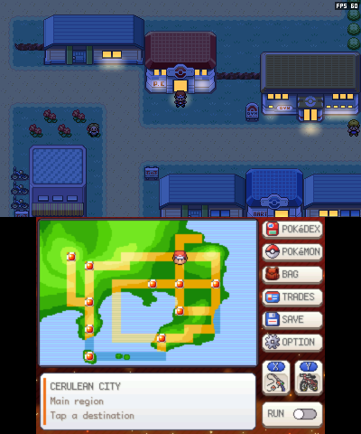

---

## The short version

- **Platform:** Nintendo 3DS / 2DS family through Homebrew Launcher, or from the HOME Menu with the optional shortcut (Luma3DS).
- **Game:** Pokémon FireRed, USA, Revision 0. Nothing else is accepted.
- **You provide:** your own ROM dump, an SD card, a Windows PC for a one-time setup step.
- **You get:** a wide overworld that follows the 3DS clock from day to night, a touch-driven lower screen, native battles with optional HeartGold sprites, LeafGreen's exclusives and night-time Pokémon in the wild, turbo, and a save file that lives next to the game.
- **Status:** alpha (v0.3.0). Author-tested on a New 3DS-family console and in the Azahar emulator. Other models are untested.

---

## What's new

**Since v0.3.0** (on `main`, coming in the next release):

- **HeartGold sprites, if you want them.** Both Builders can add Pokémon HeartGold's battle sprites and menu icons to the pack, downloaded from pret/pokeheartgold and checked file by file. They show 1:1 in battle, in the Summary, the Pokédex, the party, the PC, the Hall of Fame and the credits, with Unown's letters, Castform's weather forms and Spinda's own spots. Without them the game keeps FireRed's art.
- **The credits no longer freeze** after the Champion, when the scene reaches Charizard.
- **A web Builder** that makes the pack in the browser, and a UniStore to install the game from Universal-Updater on the console.

**In v0.3.0:**

- **Most menus on the lower screen.** The PC boxes and its menus, the item PC, the mailbox, the Hall of Fame, the Fame Checker, Teachy TV, mail and field choices all show below while the top screen keeps the field.
- **Touch everywhere.** Party in two columns with ABLE / NOT ABLE pills when teaching a move, direct taps on Pokédex rows and PC cells, lists that scroll by dragging.
- **Day and night on the GPU,** with a time-of-day option (CLOCK / FIXED / OFF and any half hour) and windows that bloom at night.
- **Faster on the Old 3DS,** with a lower screen that only redraws what changed.

The [release notes](https://github.com/alex61194/twin-embers/releases) list everything, including the stability and real-hardware fixes.

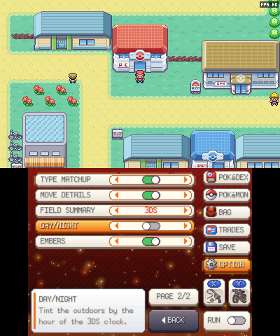 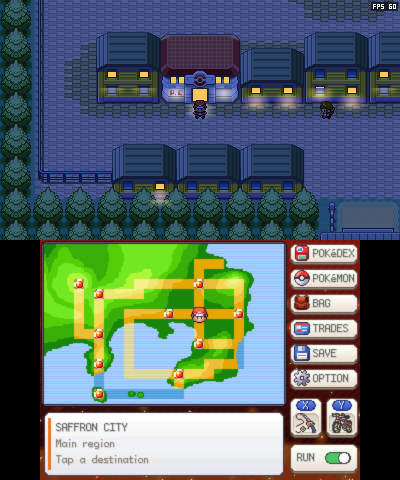

---

## A tour of the two screens

### Walking around

The overworld is drawn at the 3DS's native top-screen size instead of the GBA's 240 × 160, so you see more of every town and route before you reach its edge. Beyond a map's edge the game draws its own border, as on the GBA.

The lower screen is **PokéTouch**, a home screen with a touch Town Map and a column of buttons for the Pokédex, your party, Bag, Trainer Card, saving and options. Tapping a button opens that screen directly, and tapping another switches straight to it. Tapping a place on the map twice flies there once you can use FLY. X and Y hold your registered item and the Bicycle. The original START menu is no longer needed.

 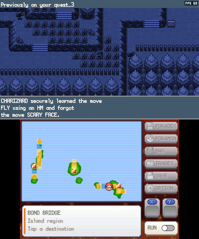

### Fighting

Battle commands move to the touch screen: a large FIGHT button with BAG, POKéMON and RUN below it, and the party's Poké Balls along the top. Picking FIGHT shows the moves as a 2 × 2 grid of cards with their type, power, accuracy and remaining PP, and a note describing the selected move, so you can choose without remembering the numbers. In a single battle each damaging move also shows how it hits the foe's types (NOT VERY, SUPER and so on). A tap also continues a battle message that waits for A.

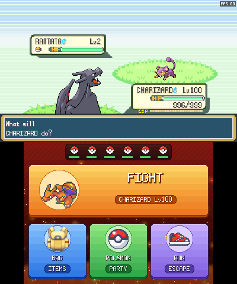 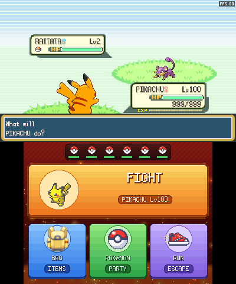

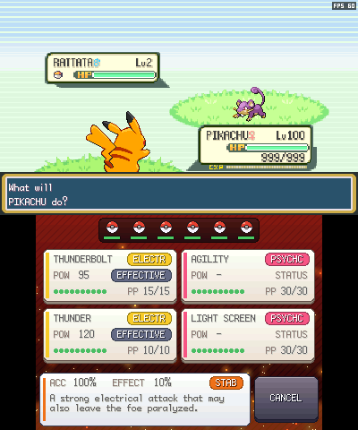 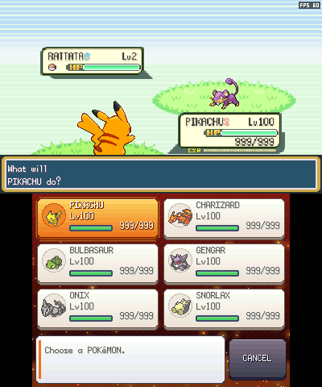

The battle Bag keeps its pockets as tabs and shows the selected item large with a USE button, and the Summary opens on the lower screen without leaving the fight.

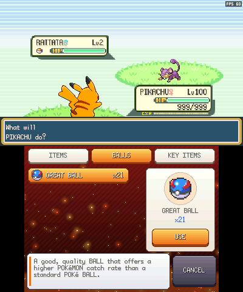 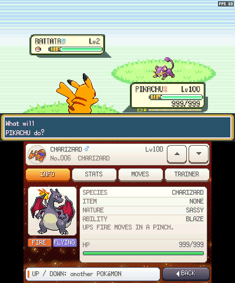

### Looking after your team

The party list, Pokémon Summary and Trainer Card each get a full lower-screen page, and the Bag and Pokédex open beside the button column. PC storage is touch-driven as well, menus included: move, withdraw and deposit by tapping. Saving asks once, with your progress shown next to it.

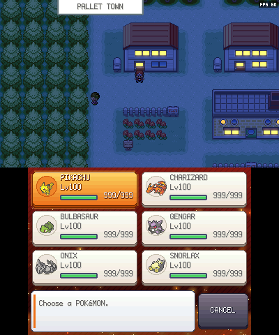 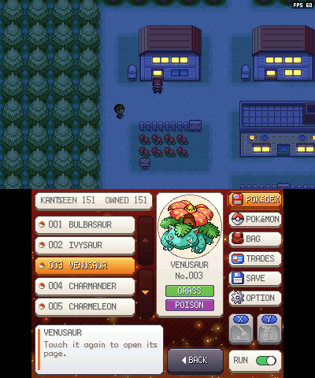

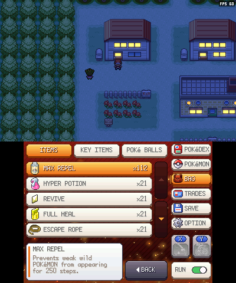 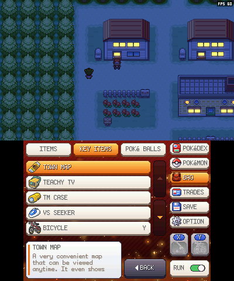

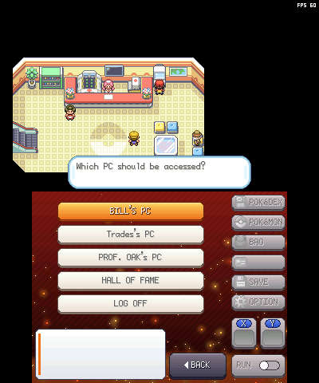 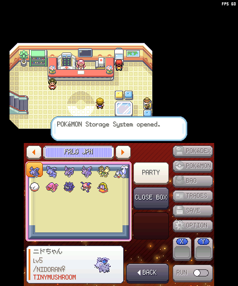

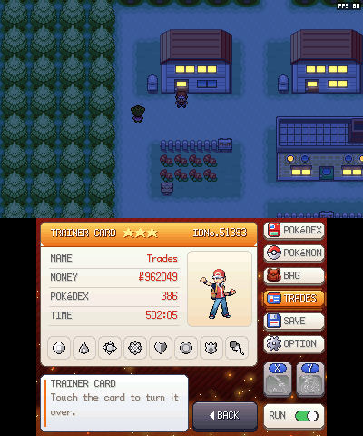 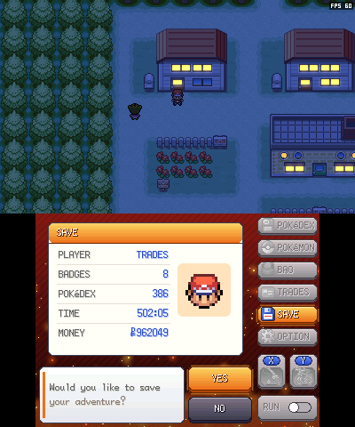

### Settings

OPTIONS has two pages. The first holds FireRed's own settings plus a switch for an on-screen FPS counter; the second holds the port's own: type matchups and move details on the battle cards, the time of day and the rising EMBERS.

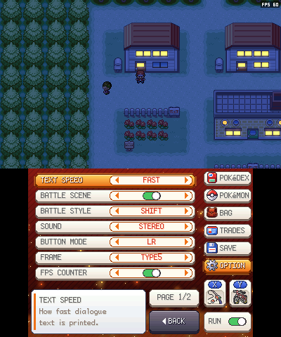 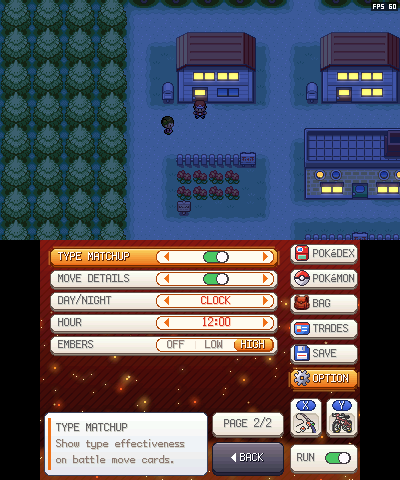

<sub>All images are real captures from Azahar (AzaharPlus) and a New 3DS-family console; the battle, menu and PC screens come from AzaharPlus with the HeartGold sprites in the pack. Native resolutions are 400 × 240 on top and 320 × 240 below. Game artwork belongs to its rightsholders.</sub>

---

## Set it up

Setup is a one-time job of about five minutes. You need three things on the SD card, and only one of them comes from you.

**1. Get the downloads** from the [latest release](https://github.com/alex61194/twin-embers/releases/latest). They are separate files:

- `twinembers.3dsx`, the game itself.
- `TwinEmbersBuilder.exe`, the Windows tool.
- `TwinEmbers-Forwarder.cia`, optional: a HOME Menu shortcut (see below).

**2. Make the data pack.** Put the SD card in your PC and start the Builder. Choose your FireRed ROM, press **SD folder…** and pick the *root* of the card, then press **Build Data Pack**. The Builder checks the ROM, writes `3ds/twinembers/twinembers.pak` and verifies what it wrote. It needs no internet and no administrator rights.

No Windows PC? The **[web Builder](https://alex61194.github.io/twin-embers/)** does the same in any recent browser, phones included: choose the ROM, press **Build twinembers.pak**, and copy the downloaded file to `3ds/twinembers/`. It runs the same Builder code on your device (Pyodide), writes the same pack byte for byte, and never uploads your ROM. Both Builders can add the optional HeartGold battle sprites, downloaded from GitHub and checked file by file.

**3. Copy the game next to it.** Place `twinembers.3dsx` in `3ds/twinembers/`.

Put the card back in the console and launch **Twin Embers** from Homebrew Launcher. The first run creates the save. When you are done the card looks like this:

```text
SD:/3ds/
├── dspfirm.cdc            (needed for sound; most custom firmware already has it)
└── twinembers/
    ├── twinembers.3dsx    you copied this
    ├── twinembers.pak     the Builder made this from your ROM
    └── twinembers.sav     the game creates this
```

### HOME Menu shortcut (optional)

`TwinEmbers-Forwarder.cia` puts a **Twin Embers** icon on the HOME Menu. Install it once with FBI or another CIA installer. It contains no game: it starts `SD:/3ds/twinembers/twinembers.3dsx`, so updating the game only ever means replacing the `.3dsx`. It needs Luma3DS; on a New 3DS it runs the game at 804 MHz with the L2 cache, and on an Old 3DS in the default mode. The Homebrew Launcher entry keeps working as before.

### Install from the 3DS itself (optional)

The game and the forwarder can be downloaded straight to the console; the pack still has to be built from your ROM (above). The QR codes are on the [web Builder page](https://alex61194.github.io/twin-embers/).

- **Universal-Updater**: add the UniStore `https://alex61194.github.io/twin-embers/twinembers.unistore` (Settings → Select UniStore → add, by QR code or typed URL). It installs `twinembers.3dsx` into `SD:/3ds/twinembers/` and, if you pick it, the HOME Menu forwarder. Both always come from the latest release, so installing again updates the game.
- **FBI**: Remote Install → Scan QR Code with the forwarder code, or type `https://github.com/alex61194/twin-embers/releases/latest/download/TwinEmbers-Forwarder.cia`. FBI installs only the CIA; the `.3dsx` still has to reach `SD:/3ds/twinembers/`.

If Windows SmartScreen warns about the Builder, compare its SHA-256 with the one in the release notes before running it. A matching hash proves it is the published file, not that the file is safe; only run what you trust.

### The ROM it accepts

| | |
|---|---|
| Game | Pokémon FireRed, USA, **Revision 0** |
| Size | 16,777,216 bytes |
| SHA-1 | `41cb23d8dccc8ebd7c649cd8fbb58eeace6e2fdc` |

Revision 1, LeafGreen, other languages, modified ROMs and trimmed dumps are refused. No ROM links are provided here or anywhere in this project.

### Coming from an older version

Copy `twinembers.sav` somewhere safe first. Replace the `.3dsx`, rebuild the pack with the Builder *from the same release* if asked (the old pack is kept until the new one is verified), and leave the save where it is. A save from the earlier `/3ds/pokefirered/` layout is copied across on first launch; the original is not modified.

---

## Using it

| Input | What it does |
|---|---|
| Circle Pad, D-Pad | Move, navigate |
| A / B | Confirm, interact / cancel, and hold B to run once you have the Running Shoes |
| START | Turbo: each press steps 2×, 3×, 4×, back to normal |
| X | Use your registered item |
| Y | Get on or off the Bicycle |
| SELECT, L, R | As in the original game |
| Touch | PokéTouch screens, battle commands, PC storage |

Turbo works while exploring and in battle. It skips drawing frames, not game logic, so the game still plays correctly at speed.

---

## When something goes wrong

- **Not listed in Homebrew Launcher.** The file must be exactly `SD:/3ds/twinembers/twinembers.3dsx`.
- **"Data pack missing."** In the Builder, press **SD folder…** and choose the root of the card, not the `3ds` folder.
- **Pack does not match the engine.** Rebuild it with the Builder from the same release as the `.3dsx`.
- **"Unsupported ROM."** Check it is FireRed USA Revision 0 against the SHA-1 above.
- **Builder cannot write.** Free at least 32 MiB and check the card's write-protect switch.
- **No sound.** Look for `SD:/3ds/dspfirm.cdc`.
- **Save error.** The message stays on the lower screen until you press A. Leave the card alone, keep your backup (`twinembers.sav.bak`), and report it.

Known gap: the Safari Zone sign still mentions START.

Each start keeps a copy of your save as `twinembers.sav.bak` in the same folder. To go back to it, copy it over `twinembers.sav` with the game closed.

To report a bug, [open an issue](https://github.com/alex61194/twin-embers/issues) with your console model or emulator, the steps that trigger it and any text the screen showed. Creating an empty `/3ds/twinembers/debug.txt` makes the game write `port.log`. **Never attach a ROM, a pack, a save or any other game data.**

---

## What is verified, and what is not

Automated tests cover the pack format, the Builder, save handling and its failure cases, the rendering paths for the touch screens and the map edge, and the audio mixer. A fresh build is also checked to confirm it embeds no game data.

Real-hardware coverage is narrower. One New 3DS-family console and Azahar have been used to play through a new game to the first rival battle, a Route 1 wild battle, saving, Continue and turbo. Older 3DS and 2DS models, long play sessions and late-game content have not been systematically tested. The [validation notes](docs/VALIDATION.md) and [hardware checklist](docs/HARDWARE-ACCEPTANCE.md) list exactly what has and has not been exercised.

## How it is put together

The pret/pokefirered decompilation is fetched at a pinned commit when you build from source and is patched by small, structured edit recipes kept in `patches/`, so this repository holds the changes and not the upstream code. The 3DS side (`3ds_port/`) supplies the display compositor, input, audio and file access. The game's graphics, sound and data are not compiled in; they are read at runtime from the pack the Builder produces from your ROM.

- [Build the 3DSX from source](docs/BUILDING.md)
- [Windows Builder](builder/README.md)
- [Web Builder and 3DS install codes](docs/WEB-BUILDER.md)
- [Pack format, ABI and saves](docs/TECHNICAL-NOTES.md)
- [Contributing](CONTRIBUTING.md) · [Security](SECURITY.md)

---

## Who made this, and under what terms

Twin Embers is directed and maintained by [alex61194](https://github.com/alex61194). **A large share of the code, tests and documentation was written with AI assistance** from Claude (Anthropic) and OpenAI Codex, then reviewed and tested by the maintainer; see [AI_DISCLOSURE.md](AI_DISCLOSURE.md). AI assistance does not stand in for the original authors' credit and gives no rights to anyone else's code or to Pokémon material.

Credit where the work is not ours:

- **ZallaxDev and the Pokémon Emerald 3Ds Dual Screen contributors** wrote the MIT-licensed backend, compositor, input and pack components this port builds on. Their notices are preserved in [NOTICE.md](NOTICE.md), [CREDITS.md](CREDITS.md) and [licenses/](licenses/).
- **@xsh3d0r_** (Discord) drew the Twin Embers logo used for this README and the HOME Menu banner.
- **kwak8709** made the HOME Menu forwarder for Twin Embers.
- **pret/pokefirered contributors** wrote the decompilation. No general redistribution licence for that code was identified, and this project's MIT licence does not cover it.
- **devkitPro, libctru, citro2d, citro3d, GCC/newlib, Python, Tcl/Tk and PyInstaller** keep their own notices ([NOTICE.md](NOTICE.md), [PROVENANCE.md](PROVENANCE.md), [Builder notices](builder/Windows-GUI-THIRD-PARTY.txt)).
- **Pokémon FireRed**, its characters, art, music and trademarks belong to Nintendo, Game Freak, Creatures and The Pokémon Company.

The [port's MIT licence](LICENSE-PORT.md) applies only to original contributions the maintainer owns. Full scope is in [CREDITS.md](CREDITS.md), [PROVENANCE.md](PROVENANCE.md) and [licenses/](licenses/); those notices are not optional.

Twin Embers is an unofficial fan project, not affiliated with or endorsed by any of the companies above. This repository contains no ROM, extracted graphics or audio, data pack or save. The separately downloadable `twinembers.3dsx` does contain compiled code derived from the pret/pokefirered decompilation, whose redistribution rights have not been independently verified; publishing it records the maintainer's decision, not anyone's permission. See the [distribution policy](docs/DISTRIBUTION.md). No licence to the original game or its decompiled code is granted or implied.
